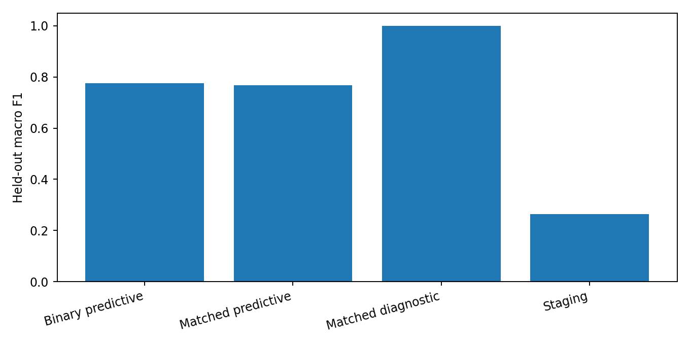

# CKD prediction and staging with NHANES data

I started this project to explore whether routine demographic, clinical, and laboratory measurements can help distinguish CKD-related outcomes. The part I found most interesting was how much the result changes when the model is given measurements that are also used to define the target label.

## What I used

- A prepared NHANES-derived dataset covering 2021–2023, supplied as `raw_dataset.csv` and `prossed_dataset.csv`. The second filename is retained as originally saved.
- Python, pandas, scikit-learn, and matplotlib.
- Logistic regression, random forest, histogram gradient boosting, and a dummy baseline.
- Five-fold stratified cross-validation on the training split for model selection; a separate 20% test split for final evaluation.

## Experiments

1. **Binary predictive model:** estimate the supplied CKD label without eGFR, ACR, or their direct laboratory inputs.
2. **Stage prediction:** use the same non-diagnostic features for the seven supplied stage labels.
3. **Matched comparison:** evaluate predictive features and diagnostic variables on the same eligible records and deterministic split. The latter is a label-reconstruction experiment.

## Results so far

| Experiment | Accuracy | Macro F1 | ROC-AUC |
|---|---:|---:|---:|
| Binary prediction | 0.776 | 0.776 | 0.849 |
| Matched prediction | 0.768 | 0.767 | 0.848 |
| Diagnostic reconstruction | 0.999 | 0.999 | 1.000 |
| Seven-stage prediction | 0.509 | 0.264 | nan |

The diagnostic reconstruction model scores almost perfectly, which is exactly why I do not present it as evidence of independent CKD prediction. Stage prediction is much harder; the later stages have very few examples. More details are in [`docs/REPRODUCED_RESULTS.md`](docs/REPRODUCED_RESULTS.md).

## What I would improve next

I still need to audit the NHANES source-code mappings and the label construction, check survey design implications, and add uncertainty estimates. I also want to revisit the original notebook's XGBoost/LightGBM and SHAP/LIME analyses after the core experiments are fully validated.

## Repository notes

- `src/` — a smaller reproducible training pipeline
- `results/` — generated evaluation outputs
- `tests/` — preprocessing checks

This repository is intended for research and teaching demonstrations, not patient diagnosis.
